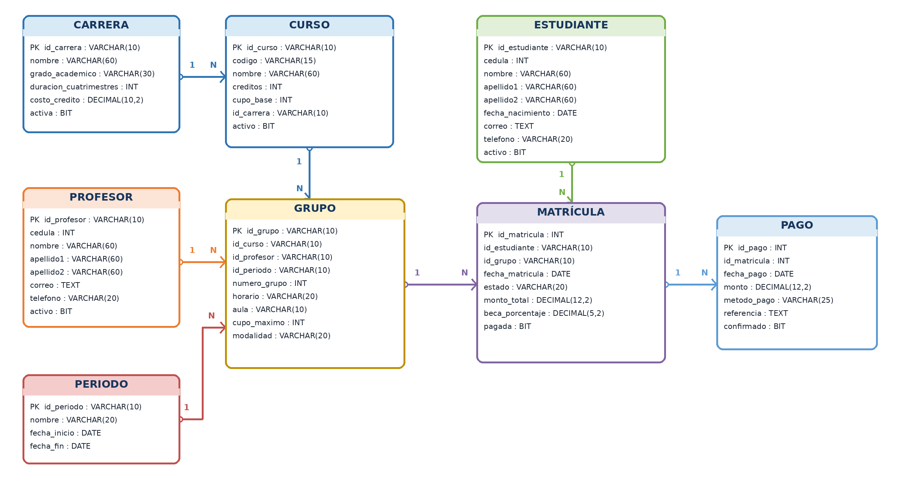

# Sistema de matrícula universitaria

Proyecto académico de **Microsoft SQL Server y T-SQL** que modela la oferta académica, la asignación de grupos y el registro de matrículas, becas y pagos. El script crea la base `db_matricula_universitaria` y carga **99 registros de ejemplo** en **8 tablas**. Incluye **6 vistas** y **29 consultas de demostración**, incluidas las consultas a esas vistas.

[Consultar el script SQL](sql/Script_SQL_Proyecto.sql) · [Descargar el informe del proyecto](docs/Informe_Proyecto_Matricula_Universitaria.docx)

## Modelo de datos



| Tabla | Información que registra | Filas de ejemplo |
| --- | --- | ---: |
| `carrera` | Programas académicos y costo por crédito | 4 |
| `curso` | Cursos, créditos y carrera asociada | 12 |
| `profesor` | Docentes que pueden impartir grupos | 8 |
| `periodo` | Períodos académicos y fechas de inicio y fin | 4 |
| `grupo` | Oferta de cursos por docente y período, con horario, modalidad y cupo | 12 |
| `estudiante` | Registros de estudiantes y su estado | 15 |
| `matricula` | Inscripción de un estudiante en un grupo, con monto, beca y estado | 24 |
| `pago` | Abonos asociados a una matrícula y su confirmación | 20 |

El diagrama representa siete relaciones de uno a muchos. El script declara claves primarias, restricciones `UNIQUE` y `CHECK`, y valores predeterminados con `DEFAULT`. Las consultas enlazan las tablas por sus identificadores. La validación de referencias mediante restricciones `FOREIGN KEY` queda pendiente en esta versión.

[Ver el diagrama de tablas de SQL Server](E-R/Diagrama_SQL.png) · [Descargar el modelo editable para draw.io](drawio/Modelo_ER_Matricula_Universitaria.drawio)

## Consultas incluidas

- Filtrar matrículas por fecha y estado, y grupos por modalidad.
- Contar cursos por carrera y estudiantes activos con agregaciones, `GROUP BY` y `HAVING`.
- Consultar el curso de cada matrícula y conservar en los resultados matrículas sin pagos o grupos sin inscripciones mediante `INNER JOIN`, `LEFT JOIN` y `RIGHT JOIN`.
- Comparar montos de matrícula con el promedio mediante una subconsulta y reutilizar consultas con vistas.

## Ejecutar el proyecto

1. Abre **SQL Server Management Studio (SSMS)** y conéctate a una instancia de SQL Server con permisos para crear bases de datos.
2. Abre [Script_SQL_Proyecto.sql](sql/Script_SQL_Proyecto.sql) y ejecuta el archivo completo. Los lotes separados por `GO` crean la base, las tablas y la carga de ejemplo, y después ejecutan las consultas y crean las vistas.
3. Actualiza el explorador de objetos y abre `db_matricula_universitaria` para revisar las tablas, las vistas y los resultados.

Si el nombre de la base ya está en uso y quieres repetir la instalación, elige un nombre de prueba distinto en las instrucciones `CREATE DATABASE` y `USE`.

### Ejemplo de consulta

En el contexto de la base del proyecto, esta consulta resume los pagos confirmados de la carga de ejemplo.

```sql
SELECT
    COUNT(*) AS cantidad_pagos_confirmados,
    SUM(monto) AS total_pagos_confirmados
FROM dbo.pago
WHERE confirmado = 1;
```

El resultado esperado es **19 pagos confirmados** por un total de **1.827.500,00**.

## Autor

**Donald Aguilar Fonseca** · Proyecto final del módulo de Manejo y Preparación de Datos.
